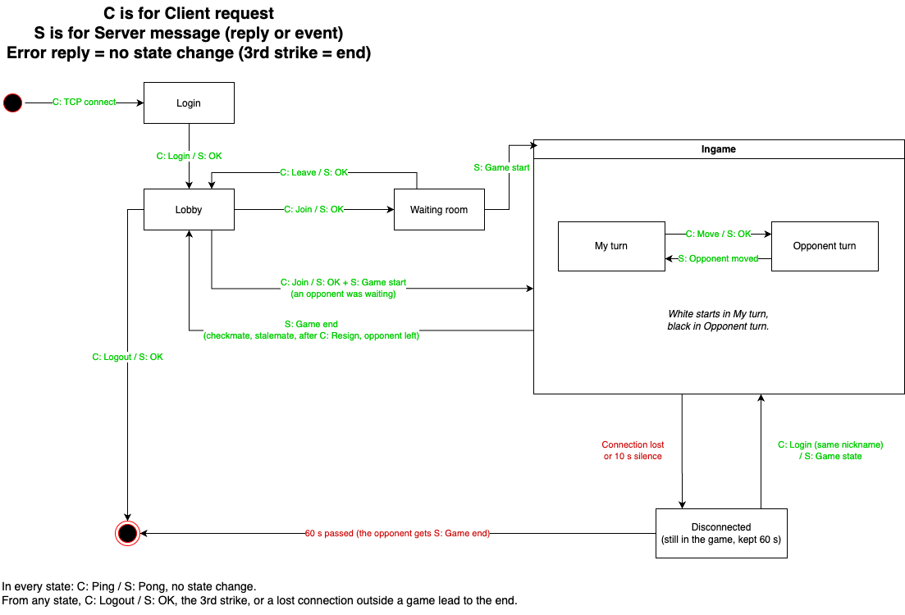

# Chess protocol

## Game

Chess for two players, simplified: no castling, no en passant, and a pawn reaching the last rank always becomes a queen. A game ends with checkmate, stalemate (draw), resignation, or when the opponent leaves. There are no draw offers and no clock. After the game both players are back in the lobby.

The server has a fixed number of rooms (1–20, set at start), each for two players. The first player in a room plays white; the game starts when the second one joins.

## Message format

- One message is one line: `OPCODE ARG1 ARG2 ...\n`, with exactly one space between the parts.
- ASCII only, no `\r`. Opcodes are upper case.
- Maximum length: 256 characters from the client, 1024 from the server (because of the room list).
- No value can contain a space or `\n`, so nothing has to be escaped.

Values:

- `nick`: 3–16 characters `[A-Za-z0-9_]`
- `room`: room number, 0 to number of rooms − 1
- `room_entry`: `room:player1:player2`, `-` for an empty spot, player1 plays white (e.g. `3:Pepa:-`)
- `move`: from square and to square, e.g. `e2e4`
- `colour`: `WHITE` or `BLACK`; `winner`: `WHITE`, `BLACK` or `DRAW`
- `reason`: `CHECKMATE`, `STALEMATE`, `RESIGN` or `OPPONENT_LEFT`
- `fen`: the position in FEN (Forsyth-Edwards Notation) (6 space-separated fields; castling and en passant always `-`)

## Messages

Every request gets exactly one reply: the one in the table, or `ERR <code>`. Apart from `PING`, the client waits for the reply before it sends another request.

| Direction | Message | Data | State | Reply |
|---|---|---|---|---|
| C → S | `PING` | – | any | `PONG` |
| C → S | `LOGIN` | nick | Login | `LOGIN_OK LOBBY`, or `LOGIN_OK GAME` and then `GAME_STATE` when returning to a game |
| C → S | `LIST` | – | Lobby | `ROOMS` |
| C → S | `JOIN` | room | Lobby | `JOIN_OK room`, then `GAME_START` if someone was waiting |
| C → S | `LEAVE` | – | Waiting | `LEAVE_OK` |
| C → S | `MOVE` | move | My turn | `MOVE_OK` |
| C → S | `RESIGN` | – | My turn, Opponent turn | `RESIGN_OK`, then `GAME_END` |
| C → S | `LOGOUT` | – | any after login | `LOGOUT_OK`, then the server closes the connection |
| S → C | `ROOMS` | count, room_entry... | Lobby | – (also sent to everyone in the lobby when a room changes) |
| S → C | `GAME_START` | own colour, opponent's nick | Waiting | – |
| S → C | `OPPONENT_MOVED` | move | Opponent turn | – |
| S → C | `OPPONENT_OFFLINE`, `OPPONENT_ONLINE` | – | in game | – |
| S → C | `GAME_END` | winner, reason | in game | – (both players are now in the lobby) |
| S → C | `GAME_STATE` | own colour, opponent's nick, `ONLINE`/`OFFLINE`, fen | after `LOGIN_OK GAME` | – |
| S → C | `ERR` | code | any | – |

## Errors

| Code | Meaning | Strike |
|---|---|---|
| `BAD_MESSAGE` | not a valid message (format, unknown opcode, wrong arguments) | yes |
| `WRONG_STATE` | not allowed now, e.g. `MOVE` when it is not the player's turn | yes |
| `INVALID_NICK`, `INVALID_ROOM`, `ILLEGAL_MOVE` | invalid value, or a move against the rules | yes |
| `ROOM_FULL` | the room is full | no |
| `SERVER_FULL` | the player limit is reached; the server closes the connection | no |

After the 3rd strike the server closes the connection and removes the player; in a game the opponent wins (`OPPONENT_LEFT`). A line longer than 256 characters closes the connection at once. The client handles invalid messages from the server the same way.

## States



| State | Description |
|---|---|
| Login | connected, not logged in yet |
| Lobby | choosing a room |
| Waiting | alone in a room, waiting for an opponent |
| My turn, Opponent turn | in a game |
| Disconnected | in a game, but the connection is lost; the server keeps the player for 60 s |

## Outages

- The client sends `PING` every 3 s. With no reply for 6 s it shows "server unreachable" and reconnects by itself, logging in with the same nickname.
- The server treats a player as unreachable when the connection closes or it hears nothing for 10 s. In a game the opponent gets `OPPONENT_OFFLINE` and the game waits.
- A player who logs in again with the same nickname within 60 s gets `LOGIN_OK GAME` and `GAME_STATE`; the opponent gets `OPPONENT_ONLINE`. If the old connection still looks alive, the new one replaces it.
- After 60 s the player is removed and the opponent gets `GAME_END` with `OPPONENT_LEFT`. The client stops after 60 s too and asks the player to reconnect manually.
- A player who is not in a game is simply forgotten when the connection is lost.

## Example

```
A: LOGIN Pepa      S→A: LOGIN_OK LOBBY
A: JOIN 0          S→A: JOIN_OK 0
B: LOGIN Anna      S→B: LOGIN_OK LOBBY
B: JOIN 0          S→B: JOIN_OK 0
                   S→A: GAME_START WHITE Anna   (Pepa plays white against Anna)
                   S→B: GAME_START BLACK Pepa   (Anna plays black against Pepa)
A: MOVE f2f3       S→A: MOVE_OK      S→B: OPPONENT_MOVED f2f3
B: MOVE e7e5       S→B: MOVE_OK      S→A: OPPONENT_MOVED e7e5
A: MOVE g2g4       S→A: MOVE_OK      S→B: OPPONENT_MOVED g2g4
B: MOVE d8h4       S→B: MOVE_OK      S→A: OPPONENT_MOVED d8h4
                   S→A, S→B: GAME_END BLACK CHECKMATE
```
